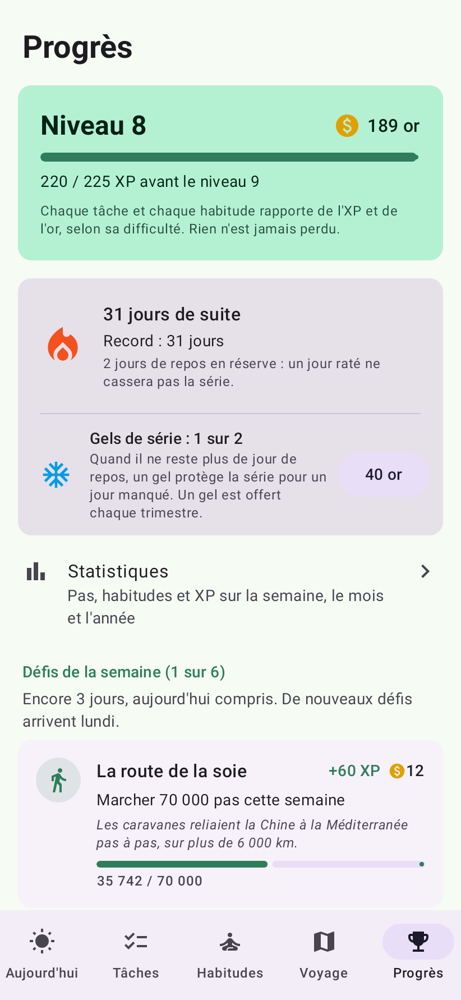

<div align="center">


# Sentier

**Une appli Android pour avancer un peu chaque jour : tâches, habitudes, pas, et un brin de jeu.**

[](https://github.com/rliu-labs/motivation-app/actions/workflows/apk.yml)
[](https://github.com/rliu-labs/motivation-app/releases/latest)
[](LICENSE)


</div>

Sentier réunit sur un seul écran ce qui compte dans la journée : les tâches à faire, les habitudes à entretenir
et les pas à marcher. Chaque petite victoire se voit tout de suite, et un jour raté n'efface jamais des semaines d'efforts.

L'appli est née d'un besoin personnel et s'inspire de trois applis libres reconnues, chacune pour ce qu'elle fait le mieux :
la gestion des tâches de [Tasks.org](https://github.com/tasks/tasks), le jeu de [Habitica](https://github.com/HabitRPG/habitica-android)
et le Material Design épuré de [Loop Habit Tracker](https://github.com/iSoron/uhabits). Toutes les données restent sur le téléphone.

## Aperçu

<table>
  <tr>
    <td align="center"><br /><sub>Aujourd'hui</sub></td>
    <td align="center"><br /><sub>Tâches</sub></td>
    <td align="center"><br /><sub>Détail d'une tâche</sub></td>
    <td align="center"><br /><sub>Habitudes et pas</sub></td>
    <td align="center"><br /><sub>Progrès</sub></td>
    <td align="center"><br /><sub>Mode nuit</sub></td>
  </tr>
</table>

<sub>Captures générées automatiquement par les tests à chaque nouvelle version.</sub>

## Fonctionnalités

**Aujourd'hui**
- Un seul écran pour la journée : tâches du jour et en retard, habitudes à cocher, pas.
- Anneau de progression et messages encourageants (« Bien joué, déjà 3 sur 5 ! »).
- Saisie rapide d'une tâche en une ligne, bouton « Annuler » après chaque validation.

**Tâches**, à la manière de Tasks.org
- Listes en couleur (Perso, Maison, Travail, et les tiennes).
- Priorité en couleur, échéance, notes et sous-tâches.
- Répétition souple : chaque jour, tous les N jours, certains jours de la semaine, chaque mois,
  à partir de l'échéance ou du jour où la tâche est finie.

**Habitudes**, à la manière de Loop Habit Tracker
- Habitudes oui/non ou chiffrées (8 verres d'eau, 10 pages…), fréquence souple (3 fois par semaine…).
- Cases des 5 derniers jours, couleur et icône par habitude, 6 modèles prêts à l'emploi.
- **Score de force** : il monte quand l'habitude est faite et baisse doucement quand elle est ratée.

**Jeu**, à la manière de Habitica
- Chaque tâche et chaque habitude rapporte de l'expérience et de l'or, selon sa difficulté.
- Niveaux, boutique de récompenses que l'on remplit soi-même (« Un dessert », « Une soirée jeu vidéo »…).
- Série de jours avec des **jours de repos** : un jour raté ne casse pas la série.
- 10 badges à débloquer. Rien n'est jamais perdu : pas de pénalité, pas de points retirés.

**Pas**
- Lecture des pas dans Health Connect, avec le capteur du téléphone en secours.
- Objectif quotidien réglable, kilomètres, 7 derniers jours et distance totale parcourue.

**Partout** : Material 3, couleurs dynamiques sur Android 12+, mode nuit, aucune publicité, aucun compte, aucune donnée envoyée.

## Installer l'appli

Sentier n'est pas sur le Play Store : l'APK se télécharge depuis GitHub. Sur le téléphone Android :

1. Ouvre la [dernière version](https://github.com/rliu-labs/motivation-app/releases/latest) et touche le fichier **`Sentier-….apk`**.
2. Ouvre le fichier téléchargé. La première fois, Android demande d'autoriser l'installation depuis le navigateur : accepte.
3. Touche **Installer**. Si Play Protect affiche un avertissement, choisis **Installer quand même** : c'est normal pour une appli hors Play Store.

Pour mettre à jour, installe le nouvel APK de la même façon : il remplace l'ancien et **garde toutes les données**.

## Feuille de route

| Étape | Contenu | État |
|---|---|---|
| 1. Les tâches | Écran Aujourd'hui, priorités, sous-tâches, listes, répétition | ✅ v0.1 |
| 2. Habitudes et pas | Habitudes avec score de force, Health Connect, objectif de pas | ✅ v0.2 |
| 3. Le jeu | Expérience, niveaux, or, boutique de récompenses, séries avec jours de repos, badges | ✅ v0.3 |
| 4. Rappels | Notification du matin, rappel du soir, validation depuis la notification | 🚧 prochaine étape |
| v2 | Voyage virtuel sur carte avec les pas, butin à collectionner, défis, widgets, sauvegarde | 💡 |

Le détail des versions est dans le [journal des versions](CHANGELOG.md).

## Sous le capot

| Besoin | Choix |
|---|---|
| Langage et interface | Kotlin 2.0, Jetpack Compose, Material 3 |
| Architecture | MVVM : écrans Compose → ViewModel → dépôts → Room |
| Données | Room (SQLite) avec migrations, DataStore pour les réglages ; XP et or tenus dans un journal d'événements |
| Pas | Health Connect, capteur `TYPE_STEP_COUNTER` relevé par WorkManager |
| Tests | JUnit, Robolectric, tests d'interface Compose, test de migration de la base |
| Intégration continue | GitHub Actions : tests, APK signé, aperçu par pull request, version à chaque fusion |

```
app/src/main/java/app/sentier/
├── data/      Entités Room, DAO, dépôts (tâches, habitudes), réglages
├── domain/    Règles métier pures : répétition (RRULE), score de force, jeu (niveaux, séries, badges)
├── steps/     Sources de pas : Health Connect, capteur, relevé en arrière-plan
└── ui/        Écrans Compose et ViewModels (today, tasks, edit, habits, progress, theme)
```

### Construire le projet

Prérequis : JDK 17 et le SDK Android (API 35).

```bash
./gradlew testDebugUnitTest   # tests unitaires, Robolectric et interface
./gradlew assembleRelease     # APK dans app/build/outputs/apk/release/
```

Sans clé de signature configurée, l'APK est signé avec la clé de debug locale. En CI, la clé vient des secrets du dépôt
`SENTIER_KEYSTORE_BASE64` et `SENTIER_KEYSTORE_PASSWORD`.

## Confidentialité

Sentier fonctionne entièrement hors ligne. Tâches, habitudes et pas sont stockés sur le téléphone, ne sont envoyés nulle part
et ne nécessitent aucun compte. L'accès aux pas (Health Connect ou capteur) se retire à tout moment dans les réglages d'Android.

## Crédits et licence

Sentier est un logiciel libre publié sous licence [GNU GPL v3.0](LICENSE) ou ultérieure.

- [Tasks.org](https://github.com/tasks/tasks) (GPL-3.0) : modèle de la gestion des tâches et des règles de répétition.
- [Habitica](https://github.com/HabitRPG/habitica-android) (GPL-3.0) : modèle du système de jeu. Aucun graphisme de Habitica n'est utilisé.
- [Loop Habit Tracker](https://github.com/iSoron/uhabits) (GPL-3.0) : style et liste d'habitudes ; formule du score de force,
  © Álinson Santos Xavier.
- Icônes [Material Symbols](https://fonts.google.com/icons) (Apache 2.0).
