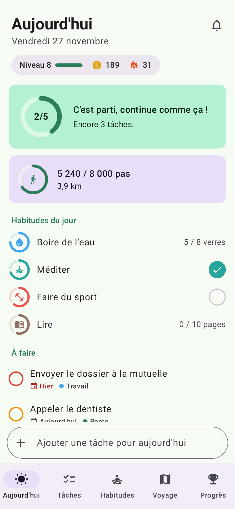
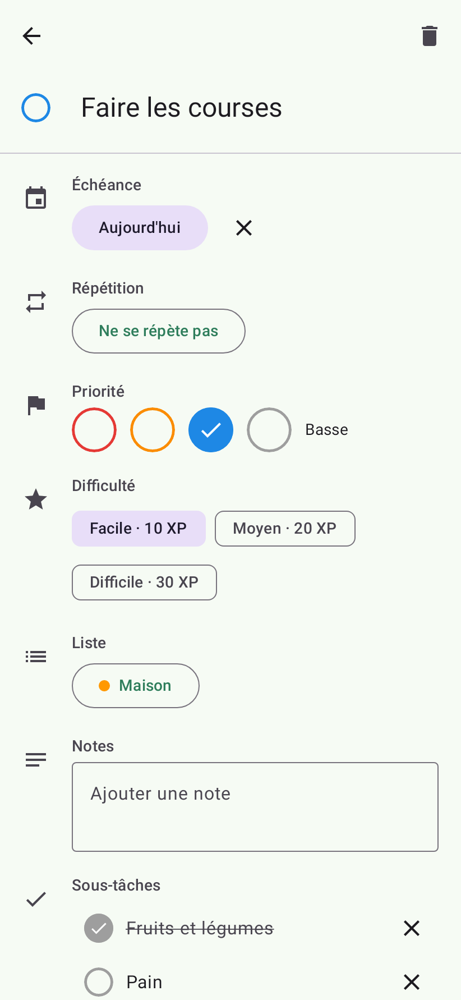
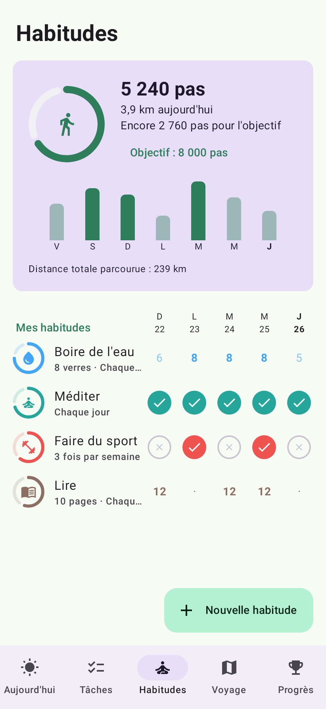
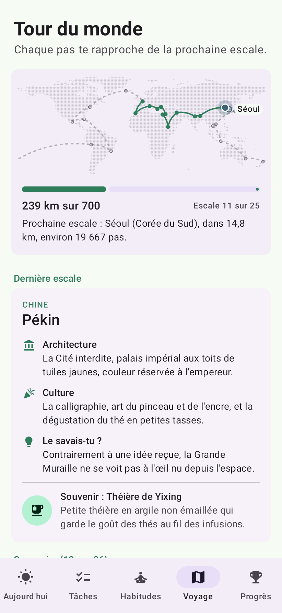
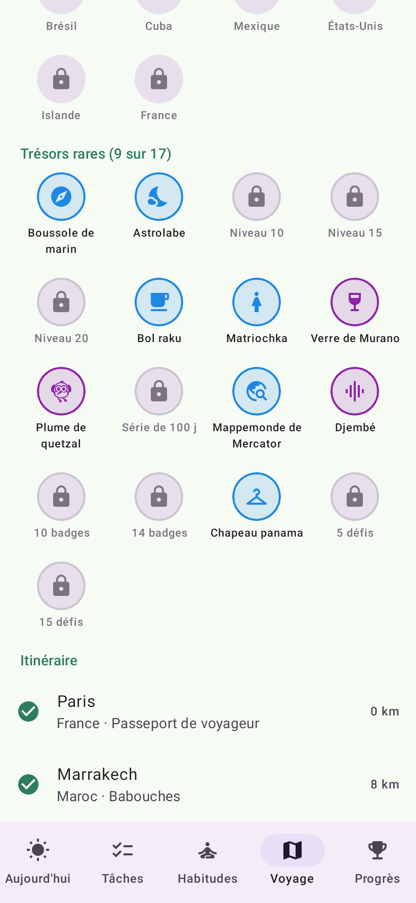
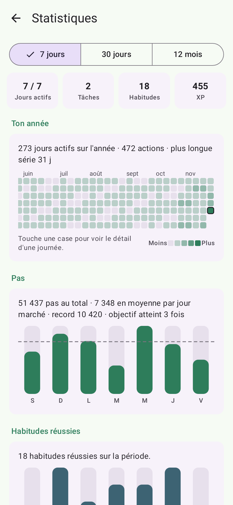
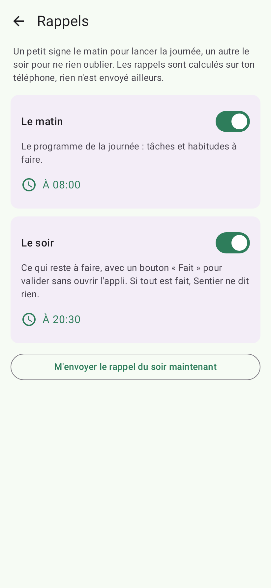
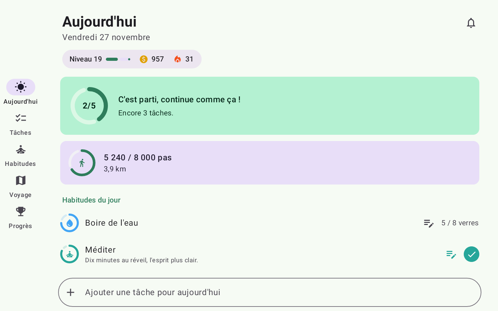
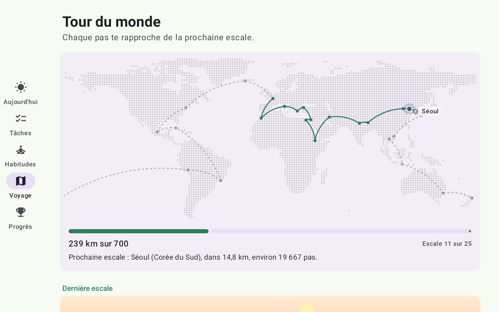

<div align="center">


# Sentier

**An Android app to make a little progress every day: tasks, habits, steps, and a touch of game.**

[](https://github.com/rliu-labs/motivation-app/actions/workflows/apk.yml)
[](https://github.com/rliu-labs/motivation-app/releases/latest)
[](LICENSE)


</div>

Sentier (French for *path*) brings what matters in a day onto a single screen: tasks to do, habits to keep,
and steps to walk. Every small win shows up right away, and a missed day never wipes out weeks of effort.

No account, no ads, no tracking: your data stays on your phone. The app's interface is in French.

## Screenshots

<table>
  <tr>
    <td align="center"><br /><sub>Today</sub></td>
    <td align="center"><br /><sub>Tasks</sub></td>
    <td align="center"><br /><sub>Task details</sub></td>
    <td align="center"><br /><sub>Habits and steps</sub></td>
    <td align="center"><br /><sub>World tour</sub></td>
    <td align="center"><br /><sub>Travel journal</sub></td>
    <td align="center"><br /><sub>Progress</sub></td>
    <td align="center"><br /><sub>Weekly challenges</sub></td>
    <td align="center"><br /><sub>Statistics</sub></td>
    <td align="center"><br /><sub>Reminders</sub></td>
    <td align="center"><br /><sub>Dark theme</sub></td>
  </tr>
  <tr>
    <td align="center" colspan="2"><br /><sub>Tablet, landscape</sub></td>
    <td align="center" colspan="2"><br /><sub>World tour on a tablet</sub></td>
  </tr>
</table>

<sub>Screenshots are generated by the test suite and refreshed automatically with every release.</sub>

## Features

**First launch**
- A short welcome: pick your first habits from the templates, set a step goal and turn on reminders, or skip it.

**Today**
- One screen for the day: tasks due today or overdue, habits to check off, steps.
- Progress ring and encouraging messages.
- One-line quick add, and an "Undo" button after every completion.

**Tasks**
- Color-coded lists (Personal, Home, Work, and your own).
- Color-coded priority, due date, notes and subtasks.
- Search titles and notes, sort by date or in your own order (drag and drop), or plan on a month calendar.
- Flexible recurrence: daily, every N days, on chosen weekdays, monthly,
  counted from the due date or from the day the task was completed.

**Habits**
- Yes/no or measurable habits (8 glasses of water, 10 pages…) with flexible frequency (3 times a week…).
- Last 5 days at a glance, a color and an icon per habit, 6 ready-made templates.
- **Habit strength** score: it grows when the habit is done and decays gently when it is missed.

**Game**
- Every task and habit earns experience and gold, according to its difficulty.
- Levels, and a reward shop you fill yourself ("A dessert", "A video game night"…).
- Day streaks with **rest days**: one missed day does not break the streak. When rest days run out, a **streak freeze**
  saves it: one free freeze every three months, more in the shop.
- 14 badges to unlock. Nothing is ever taken away: no penalties, no lost points.
- **Weekly challenges**, from Monday to Sunday, each with an XP and gold bonus: walk 70,000 steps (the Silk Road),
  work out 7 days in a row (Olympic spirit), finish 3 hard tasks (the labours of Hercules)…
- **Rare treasures** from the world's cultures, earned with levels, streaks, badges and challenges:
  a Portuguese compass, a raku tea bowl, a Murano glass, a Fabergé egg, a moai… Rare, epic or legendary,
  each comes with its story and a "did you know?" fact, kept in the travel journal next to your souvenirs.

**World tour**
- Your steps take you around the world, eastward from Paris: Marrakech, Rome, Istanbul, Petra, Lalibela, Isfahan,
  the Taj Mahal, Kathmandu, Beijing, Kyoto, Angkor, Bali, Sydney, Māori New Zealand, Cusco, Rio, Havana, Mexico City,
  New York, Reykjavik and back (25 stops, about 700 km of walking).
- Every stop has its own illustration drawn by the app, and tells you about the country's architecture and culture, with a "did you know?" fact,
  and brings back a typical souvenir for your collection: a Daruma from Japan, babouches from Morocco, a Persian rug…
- A dotted world map drawn by the app shows the legs travelled and where you are: no map service, works offline.

**Reminders**
- A morning notification with the plan for the day.
- An evening reminder of what is left, only when something is left, with a warning when the streak is at risk.
- Tick a task or a habit straight from the notification with the **Done** button, XP included.
- A reminder per habit at the time you choose, only if it is not done yet.
- Times of your choice; all reminders are off until you turn them on.

**Statistics**
- Charts of steps (with the goal line), habits done and XP earned over 7 days, 30 days or 12 months.
- Active days, best day, daily average and the success rate of each habit.

**Widgets and backup**
- A "Today" home screen widget: streak, steps and what is left for today, ticked off with one tap without opening the app.
- A small "Steps and streak" widget.
- Export all your data to a JSON file you keep wherever you like, and restore it on the same or a new phone.
  The restore asks for confirmation and is all-or-nothing: a damaged file changes nothing.
- Optional weekly automatic backup to a folder of your choice, keeping the last four.

**Steps**
- Step count from Health Connect, with the phone's step sensor as a fallback.
- Adjustable daily goal, distance, last 7 days and total distance walked.
- Optional **adaptive goal**: it follows your real pace (median of the last two weeks, plus 10%) and moves gently, so it stays within reach.

**Everywhere**: Material 3, dynamic color on Android 12+, light, dark or system theme, a side navigation rail on tablets
and in landscape, a light haptic tick when you check something off, confetti for level-ups, badges,
challenges and treasures (off when the phone's animations are off), small download (about 4 MB).

## Install

Sentier is not on the Play Store; the APK is downloaded from GitHub. On your Android phone:

1. Open the [latest release](https://github.com/rliu-labs/motivation-app/releases/latest) and tap the **`Sentier-….apk`** file.
2. Open the downloaded file. The first time, Android asks you to allow installs from your browser: accept.
3. Tap **Install**. If Play Protect shows a warning, choose **Install anyway**: this is expected for apps from outside the Play Store.

To update, install the new APK the same way: it replaces the previous version and **keeps all your data**.

## Compatibility

| | |
|---|---|
| Android version | **Android 9 (API 28) or later**, up to Android 15 (API 35, the target version) |
| Devices | Any Android phone; no Google account or Play Store needed. On tablets, foldables and in landscape, navigation moves to a side rail and content stays centered |
| Steps | **Health Connect** (built into Android 14+, a free app on Android 9 to 13) reads steps from Google Fit, Samsung Health, Fitbit and other apps. Without it, the phone's own **step sensor** is used, if the phone has one |
| Without steps | Everything else works: tasks, habits, game, challenges, statistics. Only the world tour and step goals wait for a step source |
| Widgets | Any home screen (launcher) that supports Android widgets; resizable. Light and dark previews in the widget picker on Android 12+ |
| Notifications | Reminders work on every supported version; Android 13+ asks for permission when you turn them on |
| Look | Material 3 colors that follow your wallpaper on Android 12+, Sentier's green theme before that; light, dark or system theme everywhere |
| Accessibility | Screen reader labels on charts, maps and buttons; animations follow the phone's "remove animations" setting |
| Language | Interface in French |
| Offline | Works fully offline; data stays on the phone |

## Roadmap

| Stage | Scope | Status |
|---|---|---|
| 1. Tasks | Today screen, priorities, subtasks, lists, recurrence | ✅ v0.1 |
| 2. Habits and steps | Habits with strength score, Health Connect, step goal | ✅ v0.2 |
| 3. Game | Experience, levels, gold, reward shop, streaks with rest days, badges | ✅ v0.3 |
| 4. Reminders | Morning summary, evening reminder, complete from the notification | ✅ v0.4 |
| 5. World tour | 25 stops around the world powered by your steps, culture, architecture and souvenirs | ✅ v0.5 |
| 6. Challenges and treasures | Weekly challenges with bonuses, rare cultural treasures in the travel journal | ✅ v0.6 |
| 7. Widgets and backup | Home screen widgets with one-tap completion, export and import of all data | ✅ v0.7 |
| 8. Statistics and polish | Statistics, adaptive step goal, theme choice, celebrations | ✅ v0.8 |
| 9. Welcome and habit reminders | First-launch welcome, a reminder per habit at the chosen time | ✅ v0.9 |
| 10. Task views | Search, drag-and-drop order, month calendar | ✅ v0.10 |
| 11. Safety nets | Weekly automatic backup, streak freezes | ✅ v0.11 |
| 12. Design | Tablet and landscape layout, world tour illustrations, haptics, dark widget previews | ✅ v0.12 |

Release notes are in the [changelog](CHANGELOG.md).

## Under the hood

| Concern | Choice |
|---|---|
| Language and UI | Kotlin 2.0, Jetpack Compose, Material 3 |
| Architecture | MVVM: Compose screens → ViewModels → repositories → Room |
| Data | Room (SQLite) with tested migrations, DataStore for settings; XP and gold kept as an event ledger, so any action can be undone |
| Steps | Health Connect, `TYPE_STEP_COUNTER` sensor sampled by WorkManager |
| Reminders | WorkManager jobs rescheduled daily, notification actions handled by a private broadcast receiver |
| Widgets | Jetpack Glance, refreshed when data changes |
| Backup | Plain JSON file through the system file picker (no storage permission), validated and restored in one transaction |
| Tests | JUnit, Robolectric, Compose UI tests, database migration test, screenshot generation |
| Release build | R8 code and resource shrinking, signed APK |
| CI | GitHub Actions: tests, signed APK, smoke test of the shrunk APK on an Android emulator, preview build per pull request, release on every merge |

```
app/src/main/java/app/sentier/
├── data/      Room entities, DAOs, repositories (tasks, habits, game, challenges, journey, backup), settings
├── domain/    Pure business rules: recurrence (RRULE), habit strength, game (levels, streaks, badges), challenges, treasures, world tour, adaptive goal
├── notify/    Reminders: content, scheduling, notifications and the Done button
├── steps/     Step sources: Health Connect, sensor, background sampling
├── widget/    Home screen widgets (Glance)
└── ui/        Compose screens and ViewModels (today, tasks, edit, habits, journey, progress, reminders, theme)
```

### Building

Requirements: JDK 17 and the Android SDK (API 35).

```bash
./gradlew testDebugUnitTest   # unit, Robolectric and UI tests
./gradlew assembleRelease     # APK in app/build/outputs/apk/release/
```

Without a signing key, the APK is signed with the local debug key. In CI, the key comes from the repository secrets
`SENTIER_KEYSTORE_BASE64` and `SENTIER_KEYSTORE_PASSWORD`.

## Privacy

Sentier works fully offline and requires no account. Tasks, habits and steps are stored on the phone,
and the app itself never sends them anywhere. If Android backup is turned on, the phone's own backup may include
Sentier's data in your Google account, like other apps' data, so it survives a phone change; you can turn this off
in Android settings. Step access (Health Connect or sensor) and notifications can be revoked at any time in Android settings.
Reminders are computed on the phone; no push service is involved.

## License and acknowledgements

Sentier is free software, released under the [GNU GPL v3.0](LICENSE) or later.

Some ideas come from great open-source apps: the task model and recurrence options from
[Tasks.org](https://github.com/tasks/tasks), the reward loop from [Habitica](https://github.com/HabitRPG/habitica-android),
and the habit list and strength score formula from [Loop Habit Tracker](https://github.com/iSoron/uhabits)
(formula © Álinson Santos Xavier, GPL-3.0). No code or artwork was copied from these projects.
Icons are [Material Symbols](https://fonts.google.com/icons) (Apache 2.0). The world map outline is derived from
[Natural Earth](https://www.naturalearthdata.com) (public domain).
