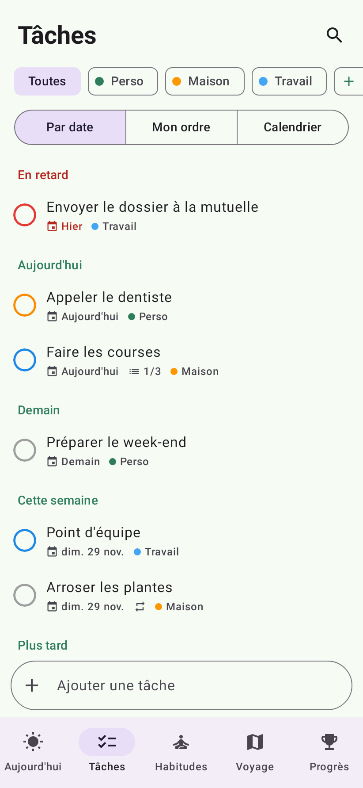
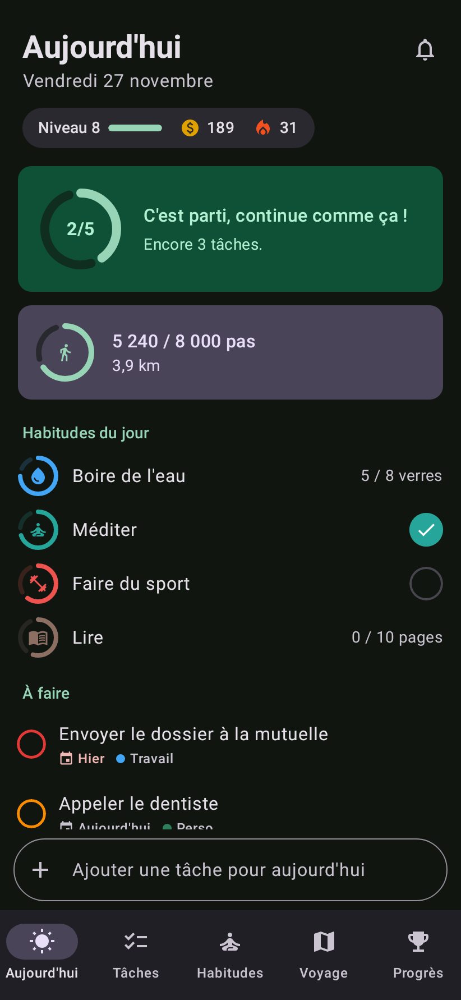

<div align="center">


# Sentier

**An Android app to make a little progress every day: tasks, habits, steps, and a touch of game.**

[](https://github.com/rliu-labs/motivation-app/actions/workflows/apk.yml)
[](https://github.com/rliu-labs/motivation-app/releases/latest)
[](LICENSE)


</div>

Sentier (French for *path*) brings what matters in a day onto a single screen: tasks to do, habits to keep,
and steps to walk. Every small win shows up right away, and a missed day never wipes out weeks of effort.

No account, no ads, no tracking: your data stays on your phone. The app's interface is in French.

## Screenshots

<table>
  <tr>
    <td align="center"><br /><sub>Today</sub></td>
    <td align="center"><br /><sub>Tasks</sub></td>
    <td align="center"><br /><sub>Task details</sub></td>
    <td align="center"><br /><sub>Habits and steps</sub></td>
    <td align="center"><br /><sub>Progress</sub></td>
    <td align="center"><br /><sub>Dark theme</sub></td>
  </tr>
</table>

<sub>Screenshots are generated by the test suite and refreshed automatically with every release.</sub>

## Features

**Today**
- One screen for the day: tasks due today or overdue, habits to check off, steps.
- Progress ring and encouraging messages.
- One-line quick add, and an "Undo" button after every completion.

**Tasks**
- Color-coded lists (Personal, Home, Work, and your own).
- Color-coded priority, due date, notes and subtasks.
- Flexible recurrence: daily, every N days, on chosen weekdays, monthly,
  counted from the due date or from the day the task was completed.

**Habits**
- Yes/no or measurable habits (8 glasses of water, 10 pages…) with flexible frequency (3 times a week…).
- Last 5 days at a glance, a color and an icon per habit, 6 ready-made templates.
- **Habit strength** score: it grows when the habit is done and decays gently when it is missed.

**Game**
- Every task and habit earns experience and gold, according to its difficulty.
- Levels, and a reward shop you fill yourself ("A dessert", "A video game night"…).
- Day streaks with **rest days**: one missed day does not break the streak.
- 10 badges to unlock. Nothing is ever taken away: no penalties, no lost points.

**Steps**
- Step count from Health Connect, with the phone's step sensor as a fallback.
- Adjustable daily goal, distance, last 7 days and total distance walked.

**Everywhere**: Material 3, dynamic color on Android 12+, dark theme, small download (about 4 MB).

## Install

Sentier is not on the Play Store; the APK is downloaded from GitHub. On your Android phone:

1. Open the [latest release](https://github.com/rliu-labs/motivation-app/releases/latest) and tap the **`Sentier-….apk`** file.
2. Open the downloaded file. The first time, Android asks you to allow installs from your browser: accept.
3. Tap **Install**. If Play Protect shows a warning, choose **Install anyway**: this is expected for apps from outside the Play Store.

To update, install the new APK the same way: it replaces the previous version and **keeps all your data**.

## Roadmap

| Stage | Scope | Status |
|---|---|---|
| 1. Tasks | Today screen, priorities, subtasks, lists, recurrence | ✅ v0.1 |
| 2. Habits and steps | Habits with strength score, Health Connect, step goal | ✅ v0.2 |
| 3. Game | Experience, levels, gold, reward shop, streaks with rest days, badges | ✅ v0.3 |
| 4. Reminders | Morning summary, evening reminder, complete from the notification | 🚧 next |
| v2 | Virtual journey on a map powered by your steps, collectibles, challenges, widgets, backup | 💡 |

Release notes are in the [changelog](CHANGELOG.md).

## Under the hood

| Concern | Choice |
|---|---|
| Language and UI | Kotlin 2.0, Jetpack Compose, Material 3 |
| Architecture | MVVM: Compose screens → ViewModels → repositories → Room |
| Data | Room (SQLite) with tested migrations, DataStore for settings; XP and gold kept as an event ledger, so any action can be undone |
| Steps | Health Connect, `TYPE_STEP_COUNTER` sensor sampled by WorkManager |
| Tests | JUnit, Robolectric, Compose UI tests, database migration test, screenshot generation |
| Release build | R8 code and resource shrinking, signed APK |
| CI | GitHub Actions: tests, signed APK, smoke test of the shrunk APK on an Android emulator, preview build per pull request, release on every merge |

```
app/src/main/java/app/sentier/
├── data/      Room entities, DAOs, repositories (tasks, habits, game), settings
├── domain/    Pure business rules: recurrence (RRULE), habit strength, game (levels, streaks, badges)
├── steps/     Step sources: Health Connect, sensor, background sampling
└── ui/        Compose screens and ViewModels (today, tasks, edit, habits, progress, theme)
```

### Building

Requirements: JDK 17 and the Android SDK (API 35).

```bash
./gradlew testDebugUnitTest   # unit, Robolectric and UI tests
./gradlew assembleRelease     # APK in app/build/outputs/apk/release/
```

Without a signing key, the APK is signed with the local debug key. In CI, the key comes from the repository secrets
`SENTIER_KEYSTORE_BASE64` and `SENTIER_KEYSTORE_PASSWORD`.

## Privacy

Sentier works fully offline and requires no account. Tasks, habits and steps are stored on the phone,
and the app itself never sends them anywhere. If Android backup is turned on, the phone's own backup may include
Sentier's data in your Google account, like other apps' data, so it survives a phone change; you can turn this off
in Android settings. Step access (Health Connect or sensor) can be revoked at any time in Android settings.

## License and acknowledgements

Sentier is free software, released under the [GNU GPL v3.0](LICENSE) or later.

Some ideas come from great open-source apps: the task model and recurrence options from
[Tasks.org](https://github.com/tasks/tasks), the reward loop from [Habitica](https://github.com/HabitRPG/habitica-android),
and the habit list and strength score formula from [Loop Habit Tracker](https://github.com/iSoron/uhabits)
(formula © Álinson Santos Xavier, GPL-3.0). No code or artwork was copied from these projects.
Icons are [Material Symbols](https://fonts.google.com/icons) (Apache 2.0).
